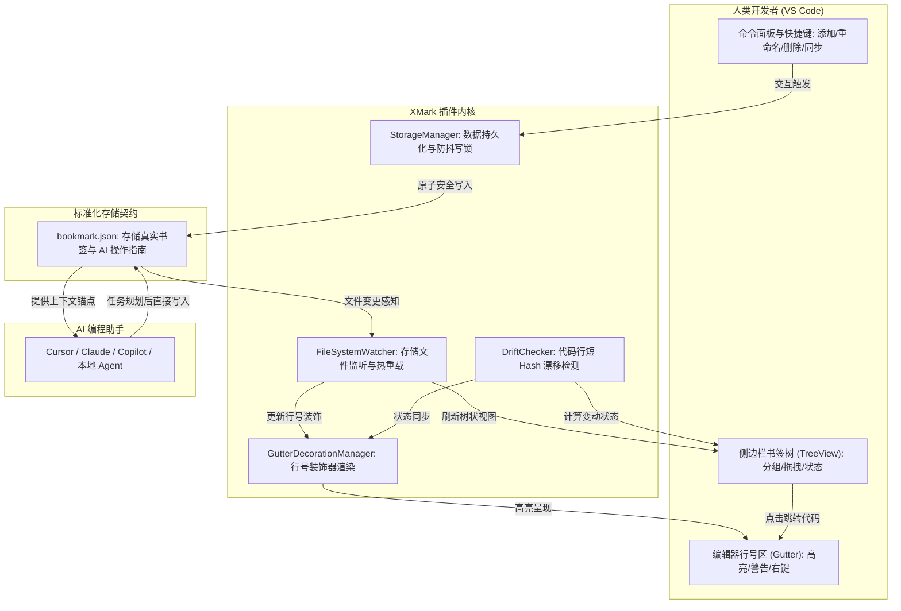

# XMark - AI Code Bookmark (代码书签)

<p align="center">
  
</p>

<p align="center">
  <strong>专为人类开发者与 AI 编程助手（Cursor / Claude / Copilot 等）深度协同打造的 VS Code 原生代码书签扩展</strong>
</p>

<p align="center">
  <a href="#-效果预览">效果预览</a> •
  <a href="#-核心特性">核心特性</a> •
  <a href="#-协同架构与流程">协同架构</a> •
  <a href="#-ai-协同使用场景与-prompt-示例">AI 协同场景</a> •
  <a href="#-存储规范契约-bookmarkjson">存储契约</a> •
  <a href="#-配置项与操作指南">操作指南</a> •
  <a href="#-构建与开发">构建开发</a>
</p>

---

## 💡 为什么选择 XMark？

在当下 AI 辅助研发的日常中，传统的代码书签插件往往面临诸多痛点：
1. **黑盒私有存储**：书签数据存放在插件私有全局状态或复杂格式中，AI 无法直接读取和分析，无法协同维护；
2. **代码漂移失效**：Git 提交或同事改动代码后，书签位置静默失效、行号错乱，排查极为痛苦；
3. **单维度限制**：一行核心代码往往兼具多个维度的关注点（例如：既是“认证业务主入口”，又是“性能瓶颈改造点”），传统插件一行只能打一个书签；
4. **工作区割裂**：对 MonoRepo 或多根工作区（Multi-root Workspace）支持不佳。

**XMark** 正是为此而生：以**透明标准的 JSON 契约**为核心，结合**智能代码漂移感知**、**单行多书签层叠高亮**与**多工作区原生适配**，让书签成为人类与 AI 之间无缝流转的结构化上下文。

---

## 📸 效果预览

### 1. 行号区高亮装饰与右键快捷管理
在编辑器行号槽（Gutter）直观呈现书签图标；支持直接在代码行号上右键唤起专属菜单，轻松完成书签添加、重命名与删除等全流程操作。

<p align="center">
  
</p>

### 2. 智能代码漂移感知与一键同步校准
当目标行代码内容发生变动时，行号区与侧边栏自动显示黄色警示图标；侧边栏支持右键一键“更新为当前位置/Commit”，拒绝随意静默错位。

<p align="center">
  
</p>

---

## 🚀 核心特性

- 🌍 **真正通用的 AI 协同 (Zero Lock-in & 开放契约)**
  - 核心存储依托完全公开、规范的 `bookmark.json`，内置自然语言契约说明（`_instructions`）；
  - **零平台绑定**：适配任意具备文件读写能力的 AI 工具（Cursor、Copilot、Claude Code、Windsurf、本地 LLM Agent 等）；
  - 内置 `FileSystemWatcher` 与防抖写锁，外部 AI 写入更新后，VS Code 侧边栏与行号区秒级热重载。

- 🔖 **首创单行多书签与多维度管理 (Multiple Bookmarks per Line)**
  - 突破传统插件限制，**允许在同一行代码上添加不同业务维度的书签**（如：功能流、重构项、Bug 追踪）；
  - 行号区自动展示**多书签层叠专属图标**，悬浮提示（Tooltip）聚合呈现当前行所有书签详情；
  - 行号区右键智能唤起快捷选择菜单，支持对单行多个书签分别重命名、删除或一键清理。

- 🔍 **智能代码漂移感知 (Code Drift)**
  - 基于目标行代码的 16 位内容短 Hash（`lineHash`）进行精准比对，避免因无关文件的 Git 提交产生误判；
  - 目标行代码变动时**坚决不随意静默挪动行号**，而在侧边栏与行号区显示 `[已变更]` 告警提示；
  - Hover 悬浮与侧边栏清晰指示变动详情，支持右键一键“更新为当前代码行内容”。

- 🎨 **精美行号区图标呈现 (Gutter Decoration)**
  - 在编辑器行号槽提供四套高对比矢量图标（单书签/单书签告警/多书签层叠/多书签告警）；
  - 与 VS Code 原生代码折叠、断点图标和谐共存，视觉层级分明。

- 🗂️ **灵活的分组管理与拖拽排序 (Drag & Drop)**
  - 支持自定义分组与受保护的系统默认分组（Default Group）；
  - 支持在书签树状视图中**拖拽排序**（组内自由调序、跨分组快速转移）；
  - 添加书签时支持一键创建新组或无缝切换目标分组。

- 💼 **多工作区与存储灵活适配 (Multi-root Support)**
  - 原生支持 VS Code 单文件夹及多根工作区（`.code-workspace`）；
  - 可自由配置存储路径（项目根目录 `bookmark.json` 或 `.vscode/bookmark.json`）。

- 🌐 **原生 i18n 国际化**
  - 严格遵循 VS Code 现代 `vscode.l10n` 原生标准，完整提供简体中文与英文支持。

---

## 🔄 协同架构与流程



---

## 🤖 AI 协同使用场景与 Prompt 示例

由于 XMark 将书签存放在规范的 `bookmark.json` 中，你可以直接在 AI 对话框中指示 AI 进行协同维护：

### 场景 1：让 AI 完成代码走查后自动标记核心位置
> **Prompt 示例：**
> “请帮我分析当前项目中的用户鉴权逻辑，理清执行链路，并在 `bookmark.json` 中为关键入口代码打上书签，按功能分类归入新分组【认证鉴权】。”

### 场景 2：让 AI 记录重构与优化候选点
> **Prompt 示例：**
> “检查当前模块中耗时较高的数据库查询或算法逻辑，在 `bookmark.json` 的【性能优化】分组中为待优化行添加书签，并简要写明优化建议。”

### 场景 3：人类标记书签，AI 针对性处理
> **Prompt 示例：**
> “查看 `bookmark.json` 中属于【待修复Bug】分组的所有书签位置，依次分析这些代码行的逻辑隐患并给出修复 PR。”

---

## 📄 存储规范契约 (`bookmark.json`)

`bookmark.json` 文件位于工作区根目录或 `.vscode` 目录下，结构开放透明：

```json
{
  "_instructions": "【XMark AI 操作指南】1. 请勿删除此字段与 groups 中的 default 分组；2. 新增书签的 groupId 必须匹配 groups 中的 id；3. filePath 必须使用 POSIX 正斜杠 /；4. lineHash 为目标行去除首尾空格后的 16 位 SHA-256 Hash 值；5. 行号 line 为 1-based 正整数。",
  "version": 1,
  "defaultGroupId": "default",
  "groups": [
    {
      "id": "default",
      "name": "默认分组",
      "order": 0
    },
    {
      "id": "group_feature_auth",
      "name": "用户认证模块",
      "order": 1
    }
  ],
  "bookmarks": [
    {
      "id": "bm_1740645001000_a1b2",
      "groupId": "group_feature_auth",
      "name": "JWT 核心验签与权限判定入口",
      "filePath": "src/services/authService.ts",
      "line": 42,
      "commit": "904419b138e62d4e8bb9b1f062d193ad4f9b8832",
      "lineHash": "a1b2c3d4e5f60718",
      "order": 0,
      "createdAt": 1740645001000
    }
  ]
}
```

### 字段说明规范

| 字段名 | 类型 | 说明与规范要求 |
| :--- | :--- | :--- |
| `_instructions` | `string` | 供 AI 快速读取的指引与约定，严禁随意删除 |
| `version` | `number` | 契约版本号，当前固定为 `1` |
| `defaultGroupId` | `string` | 默认分组 ID，必须匹配 `groups` 中的某个有效 id（默认固定为 `"default"`） |
| `groups[].id` | `string` | 分组唯一标识，默认组固定为 `"default"` |
| `groups[].name` | `string` | 分组展示名称 |
| `groups[].order` | `number` | 分组排序权重（升序） |
| `bookmarks[].id` | `string` | 书签唯一标识，建议格式 `bm_<时间戳>_<4位随机字符>` |
| `bookmarks[].groupId` | `string` | 归属分组 ID，必须对应 `groups` 中的 id |
| `bookmarks[].name` | `string` | 书签名/描述文字 |
| `bookmarks[].filePath` | `string` | 相对工作区根目录的文件相对路径（**必须使用 POSIX 正斜杠 `/`**） |
| `bookmarks[].line` | `number` | 行号（1-based 正整数） |
| `bookmarks[].commit` | `string` | 创建时的 Git HEAD Commit Hash（非 Git 仓库留空字符串 `""`） |
| `bookmarks[].lineHash` | `string` | 目标行去首尾空格后执行 SHA-256 的**前 16 位小写十六进制字符串** |
| `bookmarks[].order` | `number` | 分组内排序权重（升序） |
| `bookmarks[].createdAt` | `number` | 创建时间毫秒时间戳（13 位整数） |

---

## ⚙️ 配置项与操作指南

### 1. 扩展设置

可在 VS Code 设置中搜索 `xmark` 进行配置：

| 配置项 | 默认值 | 可选值 | 说明 |
| :--- | :--- | :--- | :--- |
| `xmark.storageLocation` | `"vscode"` | `"vscode"`, `"root"` | 书签文件存放位置：`.vscode/bookmark.json` 或项目根目录 `bookmark.json` |

### 2. 快捷操作速查

- **添加书签**：
  - 在编辑器代码行处右键，选择 **“XMark: 添加书签”**；
  - 直接在编辑器左侧**行号槽（Gutter）右键**选择添加；
  - 输入书签名时，点击右上角文件夹图标可快速切换归属分组或新建分组。
- **管理单行多书签**：
  - 当一行存在多个书签时，行号区显示层叠双书签图标；
  - 行号区右键提供专门的智能弹窗，支持按需对指定书签进行重命名或删除。
- **解决代码漂移**：
  - 当书签所在代码发生变动（侧边栏显示 `[已变更]`，行号区显示黄色告警图标）时，在侧边栏右键选择 **“更新为当前代码行内容”** 即可一键校准。
- **拖拽调序**：
  - 在侧边栏中直接拖拽书签，可调整组内顺序或拖动到其他分组中。

---

## 🛠️ 构建与开发

```bash
# 1. 安装项目依赖
npm install

# 2. 静态 TypeScript 类型检查
npm run compile

# 3. 产物打包 (输出到 dist/extension.js)
npm run build

# 4. 打包 VS Code 插件离线包 (.vsix)
npm run package
```

---

## 📄 License

[MIT](LICENSE)
