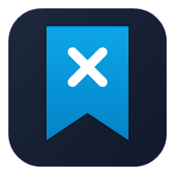
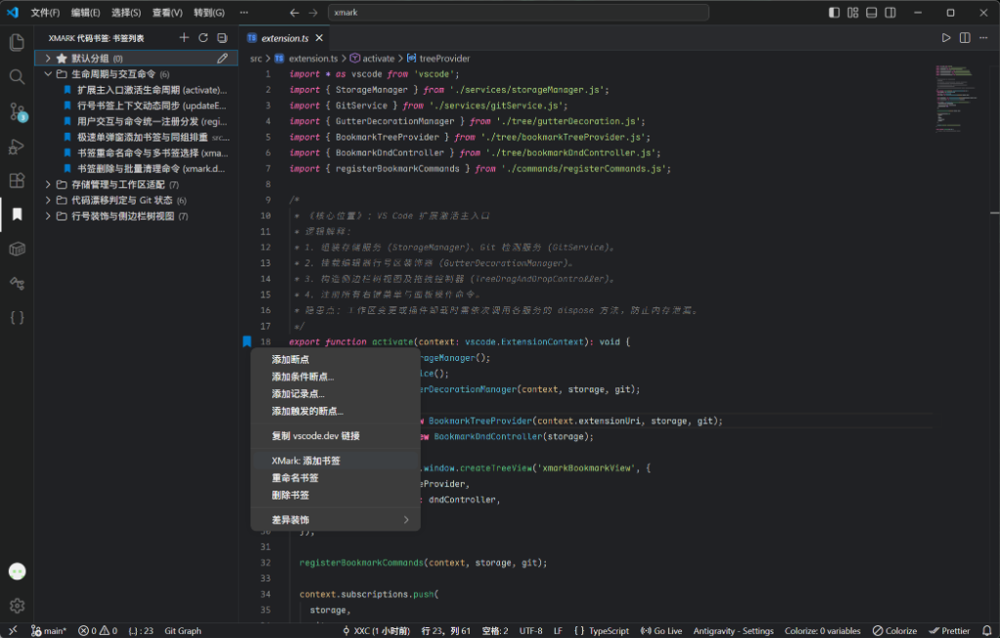
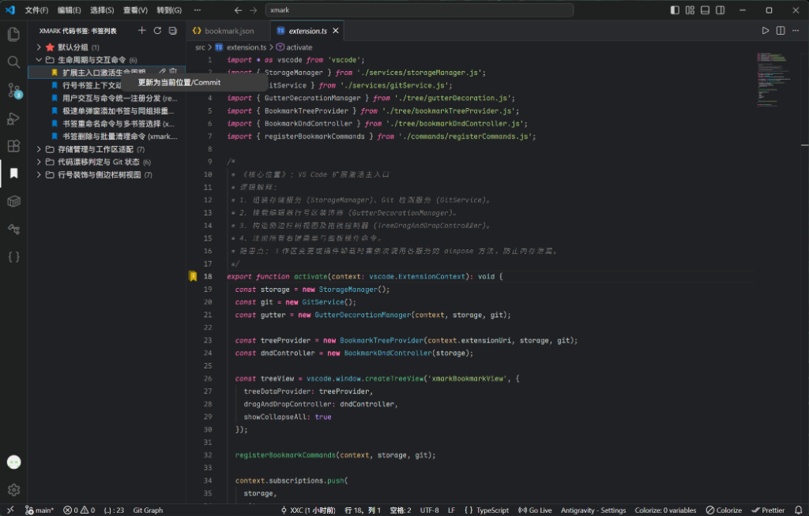

# XMark - AI Code Bookmark (代码书签)

<p align="center">
  
</p>

<p align="center">
  <strong>专为人类开发者与 AI 编程助手深度协同打造的 VS Code 原生代码书签扩展</strong>
</p>

---

## 📖 简介

**XMark** 是一款将代码书签与 AI 辅助编程无缝衔接的 VS Code 扩展。它以通用公开的 `bookmark.json` 为数据核心，原生支持**行号区图标高亮**、**单行多书签层叠**、**代码漂移感知（Hash 比对）**与**快捷复制 Commit**，既能作为人类日常开发的高效代码导航利器，也能作为 AI 理解项目结构与上下文的重要锚点。

---

## 🖥️ 使用方式

### 1. 行号区高亮与右键快捷管理
- 在编辑器代码行或左侧行号槽（Gutter）右键，即可快速**添加**、**重命名**或**删除**书签；
- 支持在单行添加多个不同维度的书签（如：业务入口、重构项），自动显示层叠图标并在 Hover 中聚合展示；
- 侧边栏书签项 Hover 浮层支持**直接点击复制 Commit Hash**，亦可通过右键菜单一键拷贝。

<p align="center">
  
</p>

### 2. 代码漂移感知与一键校准
- 当书签所在行的代码内容被修改时，系统通过目标行内容 Hash 自动感知代码漂移；
- 行号区与侧边栏自动呈现黄色警告图标，且绝不随意静默错位；
- 在侧边栏右键该书签选择 **“更新为当前代码行内容”**，即可一键完成校准同步。

<p align="center">
  
</p>

---

## 🤖 MCP 配置方式 (AI 协同)

XMark 提供了独立的 MCP (Model Context Protocol) 服务端 [`xmark-mcp`](packages/xmark-mcp)，允许 Cursor、Claude Desktop、Windsurf、Trae 等 AI 客户端直接通过标准 MCP 协议读写与校验书签。

推荐直接使用 `npx` 零安装接入：

### 1. Cursor 配置 (`~/.cursor/mcp.json` 或项目根目录 `.cursor/mcp.json`)

```json
{
  "mcpServers": {
    "xmark": {
      "command": "npx",
      "args": ["-y", "xmark-mcp"]
    }
  }
}
```

### 2. Claude Desktop 配置 (`claude_desktop_config.json`)

```json
{
  "mcpServers": {
    "xmark": {
      "command": "npx",
      "args": ["-y", "xmark-mcp"],
      "cwd": "/absolute/path/to/your/project"
    }
  }
}
```

### 3. MCP 核心能力列表

| 工具名称 | 功能描述 |
| :--- | :--- |
| `list_bookmarks` | 查询项目所有书签或按分组筛选，可附带检测代码漂移状态 |
| `add_bookmark` | 在指定文件和行号添加书签，自动提取当前行、计算 16 位 Hash 并持久化落盘 |
| `update_bookmark` | 更新书签名、行号或分组，支持自动重新计算代码 Hash |
| `delete_bookmark` | 删除指定书签 |
| `list_groups` | 获取所有书签分组及各组内包含的书签数量 |
| `create_group` / `delete_group` | 创建或删除业务书签分组 |
| `get_drift_status` | 检测指定书签是否发生代码漂移（对比当前代码行 Hash） |

---

## 📄 License

[MIT](LICENSE)
